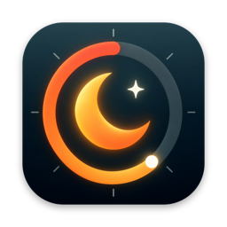

<p align="center">
  
</p>

<h1 align="center">StayAwake</h1>

<p align="center">Stay awake. Then stop.</p>

 

A menu bar switch that keeps a closed MacBook awake on battery, and switches itself off before heat, a low battery or the clock make that a bad idea. By [René Weteling](https://www.weteling.com).

Website: https://reneweteling.github.io/stayawake/

Status: early development. The core engine and the app shell exist, the switch itself does not yet.

## How it works

| Piece | What |
|---|---|
| Keep awake | `pmset -a disablesleep 1`, run by a root helper (SMAppService launchd daemon). Not a sudoers rule, not power assertions, which do not work with the lid closed on battery |
| Fail-safe | The helper holds a lease the app renews every 10 s. No heartbeat means sleep comes back within 60 s. Every boot restores sleep, and a 12 h ceiling applies no matter what |
| Helper | Runs exactly two argv arrays, `/usr/bin/pmset -a disablesleep 1` and `0`. No shell, no client strings, signed clients only |
| Sensors | HID thermal sensors for CPU and GPU, `AppleSmartBattery` for the battery, `ProcessInfo.thermalState` as a second opinion. Unreadable sensors count as a trip |

## Safety rules

| Rule | Default |
|---|---|
| CPU temperature | 100 °C (60 s average) for 120 s, clears 10 °C lower |
| GPU temperature | 95 °C (60 s average) for 120 s, clears 10 °C lower. A missing GPU sensor never trips the sensor failure rule |
| Battery temperature | 43 °C for 60 s (hottest gauge reading), clears 3 °C lower |
| Thermal pressure | serious or critical |
| Battery floor | below 40% and not charging, clears at 50% or when charging |
| Schedule | Mon to Fri 07:00 to 20:00, up to 3 windows per day |
| Lid closed on battery | 90 min |
| Idle | CPU below 10% for 15 min, lid closed |
| Watched process | off by default, none of your list for 20 min |
| No network | 15 min |
| Hard time cap | 8 h |
| Sensor failure | no valid temperature for 60 s |

Unplugging the cable while armed raises an alert, so you notice before the lid closes.

## Install

Download `StayAwake.dmg` from the [latest release](https://github.com/reneweteling/stayawake/releases/latest), open it, and drag StayAwake onto the Applications folder. Releases are signed with an Apple Developer ID and notarized.

Or build from source:

```bash
git clone https://github.com/reneweteling/stayawake.git
cd stayawake
./scripts/build.sh
cp -R build/StayAwake.app /Applications/
```

Requires macOS 14 or later on Apple Silicon and the Xcode Command Line Tools.

## Command line

```bash
StayAwake --simulate scenario.json   # run a scripted scenario through the rule engine
StayAwake --status                   # SleepDisabled and the current readings
StayAwake --report                   # every reading, the raw sensor list and the chip
StayAwake --restore                  # ask the helper for disablesleep 0
StayAwake --helper-status            # helper registration, lease and version (read-only)
```

Run them from inside the bundle, for example `/Applications/StayAwake.app/Contents/MacOS/StayAwake --helper-status`.

`--simulate` feeds snapshots through the engine with a fake clock and prints every decision. It never touches power settings. The scenario format is documented in `Sources/StayAwakeCore/Simulator.swift`.

If sleep is ever left disabled by hand, this brings it back:

```bash
sudo pmset -a disablesleep 0
```

## Privacy

No sensor data leaves the Mac. Crash reports go to Sentry with the app version and rule names, and can be switched off in Settings, General.

## Development

| Command | What |
|---|---|
| `swift test` | Core tests: rule engine, schedule, lease, forecast, config, command builder, simulator |
| `./scripts/build.sh` | Builds and ad-hoc signs `build/StayAwake.app` with the helper inside |
| `./scripts/make-dmg.sh` | Wraps the app in `build/StayAwake.dmg` with an Applications shortcut |

Code layout: `StayAwakeCore` is a pure library with no UI and no system calls. The app and the helper are thin shells over it. Releases run on every push to `main`: semantic-release picks the version from Conventional Commits, the macOS job tests, builds, signs, notarizes and attaches a notarized `StayAwake.dmg` to the GitHub release. The site in `docs/` deploys to GitHub Pages.

## License

[PolyForm Noncommercial 1.0.0](LICENSE.md). Copyright Felobo B.V. See [CONTRIBUTING.md](CONTRIBUTING.md).
